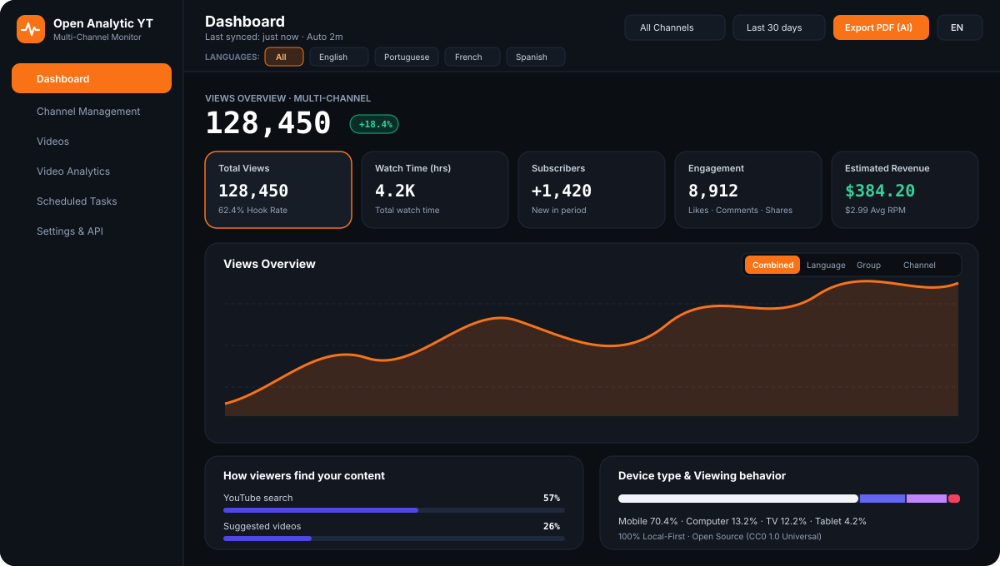

# Open Analytic YT v2.0

[](./LICENSE)
[](https://github.com/Gunfather/open-analytic-yt/releases)
[](https://react.dev/)
[](https://www.typescriptlang.org/)

Open-source multi-channel, multi-language YouTube analytics & niche intelligence suite inspired by stock/crypto tickers and YouTube Studio.



> **Privacy & Local-First:** Starts completely empty with **no pre-configured channels, groups, logins, or API keys**. All your channels, competitors, groups, API keys, SMTP settings, and scheduled tasks are stored locally in your browser (`localStorage`).

---

## What's New in v2.0

- **Niche Intelligence & Outlier Explorer** — Search any keyword/subniche across **BR, US, FR, and ES**, calculate a composite **Opportunity Score (0–100)**, detect breakout **Outlier Videos (`2x–50x` above channel average)**, and run **4-Language Arbitrage** comparisons in one click (works via YouTube Data API v3 or zero-quota local public search with 6-hour smart caching).
- **Isolated Competitor Radar** — Benchmark rival `@handles` and track their breakout outlier videos without mixing competitor numbers into your own channels' revenue or dashboard KPIs.
- **AI Reverse Engineering & Multi-Language Content Lab** — Turn top niche/competitor outliers into ready-to-produce video briefs adapted culturally for **PT-BR, EN, FR, and ES** (Titles + Thumbnail Concepts + 15s Hooks), supporting **Gemini, OpenAI, DeepSeek, Groq, OpenRouter, and NVIDIA NIM** (plus offline local diagnostics).
- **Configurable Auto-Sync (`2m`, `10m`, `20m`, `Off`)** — Flexible background sync selector with live `API` / `RSS` source indicator.

## Features

- **Multi-Channel & Multi-Language Monitoring** — Track unlimited YouTube channels across any number of languages (`English`, `Portuguese`, `French`, `Spanish`, plus custom languages you add).
- **Custom Channel Groups** — Group channels by brand, niche, or project and filter the entire dashboard, charts, and reports by group.
- **Keyless Public Sync + Optional YouTube Data API v3** — Sync public channel stats (subscribers, views, avatar, and latest 15 videos via YouTube public feed/RSS) **without needing a Google Cloud API key**, or optionally connect your own YouTube Data API v3 key.
- **Auto-Sync Every 20 Minutes** — Built-in toggleable auto-sync (`Auto 20m`) to keep your metrics fresh without burning API quota.
- **YouTube Studio CSV Import** — Import exported Analytics `.csv` files for exact Watch Time and Revenue.
- **Advanced Mode (Scatter Plot)** — Compare video performance (`Best`, `Average`, `Worst`) across time since publish (`First 24 hours`, `First 48 hours`, `First 7 days`, `All time`).
- **Studio-Style Audience Cards** — Traffic sources, Top demographic, Viewing behavior, Videos growing your audience, Device type, Top geographies, Age, and Gender (each with **Hide / Show** toggles).
- **AI-Ready PDF Export** — Customize filters (Period, Language, Group, Channel), sections, and custom AI instructions to download a clean vector `.pdf` ready for ChatGPT, Claude, or Gemini.
- **Scheduled Email Reports** — Schedule daily, weekly, monthly, or one-time PDF email reports via SMTP (`nodemailer`) with **Edit** and **Enable / Disable** controls.
- **4-Language Interface** — Switch the UI between **English (default)**, **Portuguese (BR)**, **French**, and **Spanish**.

---

## How to Use

### 1. Installation & Running Locally

**Requirements:** [Node.js](https://nodejs.org/) (v18+ recommended).

```bash
git clone https://github.com/Gunfather/open-analytic-yt.git
cd open-analytic-yt
npm install
npm run dev
```

Open `http://localhost:5173` in your browser.  
*(On Windows, you can also double-click `start_open-analytic-yt.bat` to install dependencies if needed, start the server, and open your browser automatically.)*

### 2. Adding Your Channels (No API Key Required)

1. Go to **Channel Management** in the left sidebar.
2. Click **Add Channel** and enter the channel name, `@handle` (e.g., `@YourChannel`), or `Channel ID` (`UC...`), select its **Language**, and save.
3. Click **Sync** (top right) or the refresh icon on the channel card — public channel stats and recent videos will load automatically.
4. *(Optional)* To use an official YouTube Data API v3 key instead, go to **Settings & API** and paste your key.

### 3. Creating Languages & Groups

- In **Channel Management**, click **+ New Language** to add more languages anytime.
- Click **+ New Group** to group channels together (e.g., by brand or niche), then filter the entire dashboard from the top bar.

### 4. Exporting AI-Ready PDF Reports

- Click **Export PDF (AI)** in the top bar.
- Choose your **Period** (`24h`, `48h`, `7d`, `14d`, `30d`, `90d`), **Language**, **Group**, **Channel**, which sections to include, and an optional **AI instruction**.
- Click **Download Custom PDF** to save the `.pdf` file directly.

### 5. Scheduling Email Reports

1. Open **Scheduled Tasks** in the left sidebar.
2. Click **Configure Email (SMTP)** and enter your SMTP credentials (for Gmail, use an [App Password](https://myaccount.google.com/apppasswords)).
3. Click **New Scheduled Task**, choose the recipient email, frequency (`Daily`, `Weekly`, `Monthly`, or `Specific Date`), exact time, and report filters.
4. Keep the local server running (`npm run dev` or `start_open-analytic-yt.bat`) for automatic background dispatch, or click **Send Now** to test immediately.

---

## License

This project is dedicated to the public domain under **CC0 1.0 Universal**.  
You can copy, modify, distribute, and use it freely for any purpose, even commercially, without asking permission. See [LICENSE](./LICENSE) for details.
